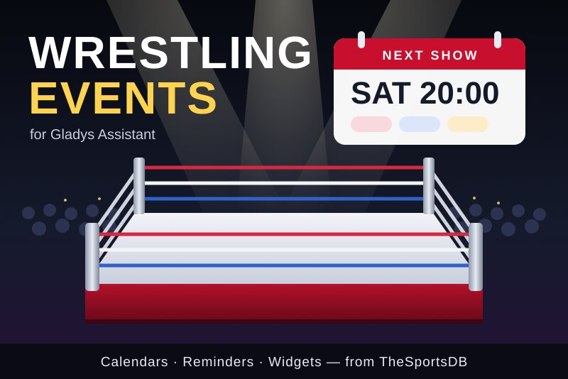
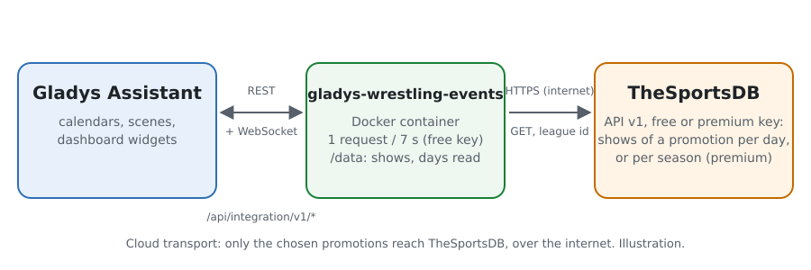
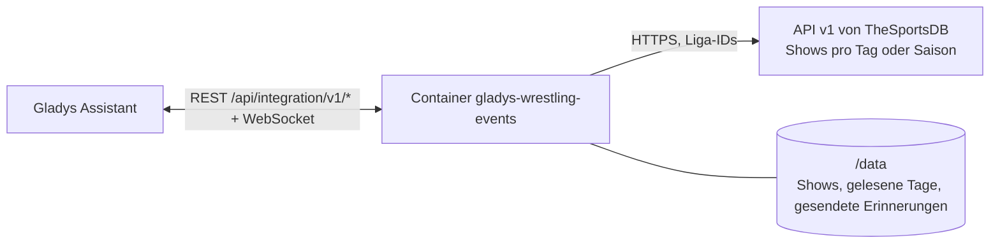
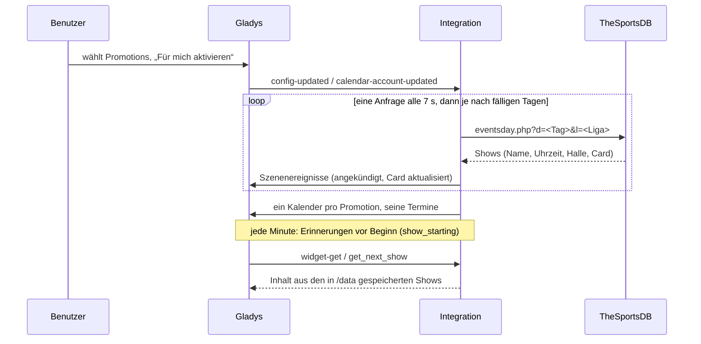
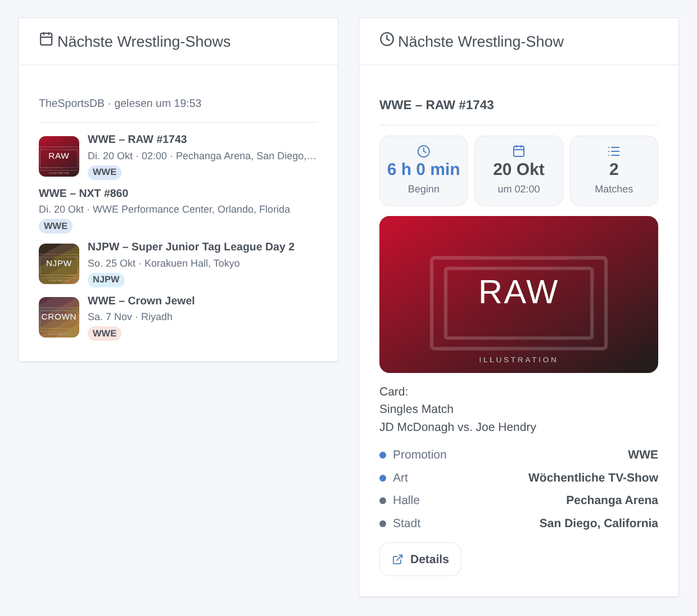

# Gladys Wrestling Events

[English](README.md) · [Français](README.fr.md) · **Deutsch** · [Español](README.es.md)

[](LICENSE)
[](https://github.com/William-De71/gladys-wrestling-events/releases)
[](https://github.com/William-De71/gladys-wrestling-events/actions/workflows/release.yml)
[](https://gladysassistant.com)



Eine externe Integration für [Gladys Assistant](https://gladysassistant.com), mit der Sie **Profi-Wrestling** verfolgen: Die Shows von WWE, AEW, NJPW, TNA, AAA und neun weiteren Promotions landen im Kalender von Gladys, mit Uhrzeit, Halle und Card. Szenen schalten den Fernseher vor dem ersten Gong ein, zwei Dashboard-Widgets zeigen, was ansteht.

Benutzerdokumentation: [English](docs/en.md) · [Français](docs/fr.md) · [Deutsch](docs/de.md) · [Español](docs/es.md).

> Community-Integration, weder mit TheSportsDB, Cagematch noch einer Promotion verbunden oder von ihnen unterstützt.

## Funktionen

- **14 Promotions** zur Auswahl in einer Liste: WWE, AEW, NJPW, TNA, AAA, ROH, CMLL, Stardom, AJPW, DDT, Dragon Gate, GCW, RevPro, MLP.
- **Drei Arten von Shows**, jede lässt sich abwählen: wöchentliche TV-Shows (RAW, SmackDown, NXT, Dynamite, Collision, AAA on FOX …), Tour-Shows („Day 1“, „Day 2“ …) und Großevents (Premium Live Events, Pay-per-Views, Specials).
- **Ein Kalender pro Promotion** für jeden Benutzer, der die Integration unter „Meine Kalender“ aktiviert: Termine mit Uhrzeit, wenn sie bekannt ist, sonst ganztägig, mit Halle, Card und einem Link zu TheSportsDB.
- **3 Szenenauslöser**, **1 Szenenaktion** und **2 Dashboard-Widgets** (siehe unten).
- Der **kostenlose Schlüssel** von TheSportsDB (30 Tage im Voraus) oder Ihr **Premium-Schlüssel** (90 Tage, ganze Saisons auf einmal).
- Vier Sprachen überall: Englisch, Französisch, Deutsch, Spanisch.

## Funktionsweise





Das Programm stammt von [TheSportsDB](https://www.thesportsdb.com), einer offenen Sportdatenbank, die ihre Community aktuell hält und Wrestling unter „Fighting“ führt, eine Liga pro Promotion. Zuerst war [Cagematch](https://www.cagematch.net) vorgesehen: Es hat keine API, schützt seine Seiten gegen automatisierte Zugriffe und verlangt von Robotern eine Anfrage alle 9 Minuten; die Integration liest es deshalb nicht.

Mit dem **kostenlosen Schlüssel** fragt die Integration **einen Tag einer Promotion pro Anfrage** ab, eine Anfrage alle 7 Sekunden: die Tage von gestern bis übermorgen alle 3 Stunden (Uhrzeiten, Cards und Ergebnisse ändern sich), die weiteren Tage einmal täglich. Das erste Lesen von 30 Tagen für 5 Promotions dauert etwa 20 Minuten; nach einem Neustart wird nur gelesen, was fällig ist. Mit einem **Premium-Schlüssel** ist eine ganze Saison einer Promotion eine Anfrage, alle 3 Stunden.

Jede Antwort ersetzt die für diesen Tag gespeicherten Shows: Eine abgesagte Show verschwindet aus dem Kalender, eine verschobene zieht mit. Die Änderungen lösen die Szenen aus, danach werden die Kalender der Benutzer, die die Integration aktiviert haben, neu veröffentlicht.



### Transport

Nur Cloud (`"transports": ["cloud"]`): Der Katalog zeigt das Cloud-Abzeichen. Nur die Liga-IDs der gewählten Promotions und die abgefragten Tage gehen an `www.thesportsdb.com`; die Poster der Widgets werden von `r2.thesportsdb.com` geladen, wenn ein Dashboard sie zeigt. Nichts über Sie oder Ihr Zuhause verlässt Ihr Netzwerk. Es gibt keinen lokalen Weg, daher keine Schaltfläche „Lokale Verbindung bevorzugen“.

## Kalender und Termine

Keine Geräte: Gladys erlaubt einer Integration nicht, zugleich Kalender- und Geräteintegration zu sein. Jede verfolgte Promotion ist ein Kalender, für jeden Benutzer, der die Integration aktiviert hat.

| Element            | Inhalt                                                                                          |
| ------------------ | ----------------------------------------------------------------------------------------------- |
| Kalender           | „Wrestling – WWE“, Farbe der Promotion, privat, bis Sie ihn teilen                              |
| Termin mit Uhrzeit | Beginn der Show, geschätztes Ende (2 Std. für eine TV-Show, 3 Std. für eine Tour-Show, sonst 4) |
| Ganztägiger Termin | Wenn TheSportsDB die Uhrzeit noch nicht kennt, am Tag vor Ort                                   |
| Titel              | Promotion und Name: „WWE – Crown Jewel“; „(verschoben)“, wenn das zutrifft                      |
| Ort                | Halle, Stadt und Land                                                                           |
| Beschreibung       | Die Card (ein Match pro Zeile), die Art der Show, die Quelle                                    |
| Link               | Die Seite der Show auf TheSportsDB                                                              |

Das Fenster reicht von 7 Tagen zurück bis zum Horizont (14 oder 30 Tage, 60 oder 90 mit Premium-Schlüssel). Unter „Meine Kalender“ kann jeder Benutzer die Synchronisierung eines Kalenders beenden oder ihn **mit dem Haushalt teilen**: Nur ein geteilter Kalender erreicht die Szenen des Haushalts und den eingebauten Auslöser „Kalenderereignis steht bevor“.

## Szenenauslöser, Aktionen und Widgets



**Szenenauslöser** (einmal pro Übergang; ein zum ersten Mal gelesener Tag kündigt nichts an). Filter: Promotions, Arten von Shows.

- **Eine Show beginnt**: zu Beginn oder 15, 30, 60 bzw. 120 Minuten vorher (Filter „Wann“). Nur wenn die Uhrzeit bekannt ist, nie für eine verschobene Show.
- **Neue Show angekündigt**: Eine Show erscheint an einem bereits gelesenen Tag (bei TheSportsDB hinzugefügt, nicht nur zum ersten Mal gesehen).
- **Matches zur Card hinzugefügt**: neue Matches auf der Card einer kommenden Show (`new_matches`, eines pro Zeile).

Die Variablen: `title`, `name`, `promotion`, `promotion_name`, `kind`, `date`, `time`, `venue`, `city`, `country`, `place`, `card`, `url`, `show_id` (sowie `lead_minutes`, `new_matches`, `new_match_count`).

**Szenenaktion**: **nächste Show** (bestimmter Promotions oder Arten): Titel, Datum, Uhrzeit, Ort, Minuten bis zum Beginn, Card, Link und ein fertiger Satz („Nächste Show: WWE – RAW #1743, Dienstag 20. Oktober um 02:00, Pechanga Arena …“).

**Widgets**: **Nächste Wrestling-Shows** (eine Liste mit Datum, Uhrzeit, Halle, einem Abzeichen pro Promotion und dem Poster; ein Tippen öffnet die Card) und **Nächste Wrestling-Show** (Countdown, Uhrzeit, Anzahl der Matches, Poster, Halle und Card). Einstellungen: Promotions, Arten von Shows, Anzahl der angezeigten Shows.

Beispiele:

- Wenn **ein Großevent von WWE oder AEW in 15 Minuten beginnt** → Fernseher einschalten, Wohnzimmerlicht dimmen.
- Wenn **eine neue NJPW-Show angekündigt wird** → mir `{{triggerEvent.data.title}}, {{triggerEvent.data.date}} in {{triggerEvent.data.city}}` schicken.
- Jeden Montag um 9 Uhr → **die nächste Show abrufen** und `{{text}}` per Telegram senden.

## Voraussetzungen

- Gladys Assistant **5.3.0** oder neuer (Kalenderintegrationen; Katalog-Schlagwörter und -Länder von Gladys 5.3). Ältere Instanzen können die Integration nicht installieren.
- Internetzugang. Kein Konto; ein Premium-Schlüssel von TheSportsDB ist optional.

## Installation

- **Aus dem Gladys-Store** (Integrationen → Externe Integrationen), mit einem Klick, sobald indexiert.
- **Über die URL des Repositorys**: `https://github.com/William-De71/gladys-wrestling-events`.
- **Entwicklermodus**: das Image lokal bauen (`docker build -t gladys-wrestling-events .`) und aus Gladys installieren.

## Konfiguration

| Feld                             | Beschreibung                                                                                 |
| -------------------------------- | -------------------------------------------------------------------------------------------- |
| Promotions                       | Die zu verfolgenden Promotions (standardmäßig WWE, AEW, NJPW, TNA und AAA). Je ein Kalender. |
| Arten von Shows                  | Wöchentliche TV-Shows, Tour-Shows, Großevents (standardmäßig alle).                          |
| Programm im Voraus               | 2 Wochen, 30 Tage (Standard); 60 oder 90 Tage mit Premium-Schlüssel.                         |
| Premium-API-Schlüssel (optional) | Der Schlüssel eines TheSportsDB-Abos. Leer: der kostenlose Schlüssel.                        |
| Sprache der Szenentexte          | Automatisch (die Sprache des Dashboards) oder eine feste Sprache, für den Satz der Aktion.   |

Drücken Sie danach auf derselben Seite unter **Meine Kalender** auf **Für mich aktivieren**: Jeder Benutzer, der die Kalender möchte, aktiviert die Integration für sich selbst.

## Verwendung

1. Promotions und Arten von Shows wählen, dann speichern.
2. Unter **Meine Kalender** auf **Für mich aktivieren** drücken; die Kalender mit dem Haushalt teilen, um sie in Szenen zu nutzen.
3. Die Widgets einem Dashboard hinzufügen und Szenen mit den obigen Auslösern anlegen.

## Entwicklung

```bash
npm install
npm test                       # node --test, ohne Netzwerkzugriff
npm run lint && npm run format:check
npx github:GladysAssistant/integration-store . --skip-image-check
scripts/build-cover.sh         # cover.jpg aus docs/assets/cover.svg
docs/illustrations/render.sh   # docs/assets/widgets.<Sprache>.png
node .github/scripts/release.mjs next
```

Lokal liest das SDK `GLADYS_HOST_API_URL`, `GLADYS_INTEGRATION_TOKEN` und `GLADYS_INTEGRATION_SELECTOR`, und `TZ` legt die Zeitzone der angezeigten Uhrzeiten fest; `DEBUG=gladys-integration-sdk` gibt die SDK-Protokolle aus und prüft jeden Widget-Inhalt. Die Tests nutzen echte, gekürzte Antworten von TheSportsDB (`test/fixtures/`). Die Regeln des Projekts stehen in [CLAUDE.md](CLAUDE.md).

## Release-Prozess


Jeder Merge auf `main` startet die CI und berechnet dann die Version aus den [Conventional Commits](https://www.conventionalcommits.org/de/) seit dem letzten Tag: `feat` → Minor, `fix` / `perf` → Patch, `!` oder `BREAKING CHANGE` → Major (vor 1.0.0 ein Minor); `docs`, `chore`, `ci`, `test`, `style`, `refactor`, `build` allein veröffentlichen nichts. Der Changelog-Abschnitt wird erzeugt, der Tag gepusht, das Multi-Arch-Image gebaut, dann erhält `main` den Release-Commit, die GitHub Release wird angelegt, und ein letzter Job prüft das öffentliche Image, den Store-Validator und das Topic.

- Der Titel des Pull Requests wird zum Squash-Commit und dann zur Zeile im Changelog: auf Englisch, für den Benutzer schreiben (`pr-title.yml` prüft ihn). `CHANGELOG.md` nie von Hand bearbeiten.
- 1.0.0 ist eine Entscheidung: Actions → Release → Run workflow mit `release-as: 1.0.0`. `dry-run` zeigt Version und Notizen, ohne etwas zu veröffentlichen.
- **Geschützter Branch**: Die Release pusht ihren Commit mit `GITHUB_TOKEN` auf `main`. Mit einem Ruleset auf `main` GitHub Actions in die Bypass-Liste aufnehmen (oder über eine GitHub App pushen), sonst schlägt der Publish-Job mit einer Erklärung fehl.
- Nach der ersten Release das `ghcr.io`-Paket öffentlich machen (Package settings → Change visibility), sonst kann Gladys es nicht herunterladen.

## Fehlerbehebung

Siehe [docs/de.md](docs/de.md#fehlerbehebung). Melden Sie Probleme mit den Versionen von Gladys und der Integration, den verfolgten Promotions, kostenlosem oder Premium-Schlüssel und den Zeilen des Reiters Protokolle.

## Mitwirken

Issues und Pull Requests sind willkommen. Vor einem Pull Request `npm run format:check && npm run lint && npm test` ausführen und keine externe ID oder gespeicherten Schlüssel ändern (siehe [CLAUDE.md](CLAUDE.md)). Eine fehlende Promotion kann ergänzt werden, wenn TheSportsDB sie als Liga mit aktuellem Programm führt.

## Sicherheit

Siehe [SECURITY.md](SECURITY.md): Schwachstellen bitte vertraulich melden. Der Premium-Schlüssel ist ein geheimes Feld und erscheint nie in den Protokollen; die Integration läuft schreibgeschützt, ohne Root-Rechte, in ihrem Container und kontaktiert nur TheSportsDB.

## Kommende Screenshots

Die Bilder oben sind Illustrationen, keine Screenshots. Echte Screenshots kommen nach `docs/assets/screenshots/` (PNG, 1280 × 800): `configuration.png`, `my-calendars.png`, `calendar.png`, `scene.png`.

## Lizenz

[Apache-Lizenz 2.0](LICENSE) — siehe auch [NOTICE](NOTICE). Das Programm stammt von [TheSportsDB](https://www.thesportsdb.com): Die Widgets zeigen die Quelle und die Uhrzeit des letzten Lesens. Danke an die Dokumentation und das SDK von Gladys.
