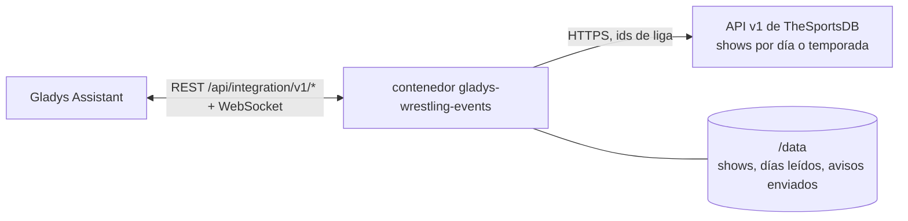
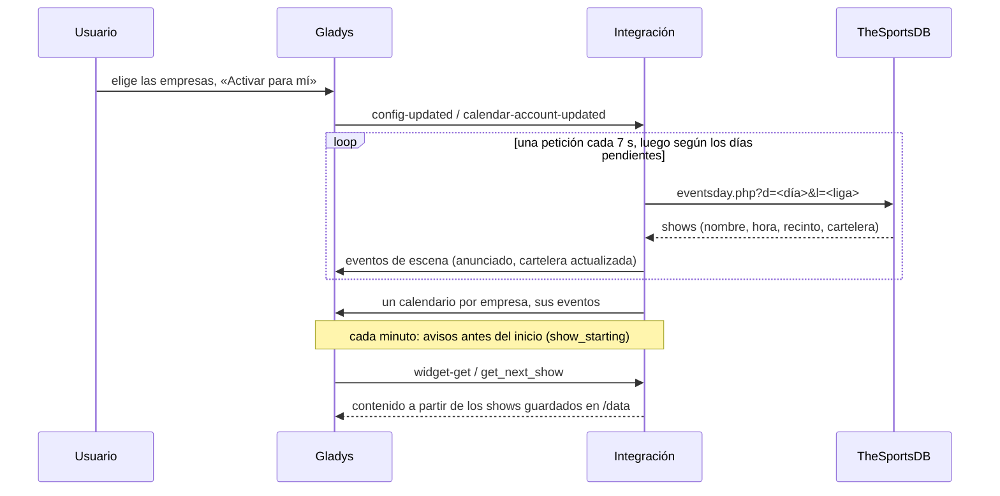
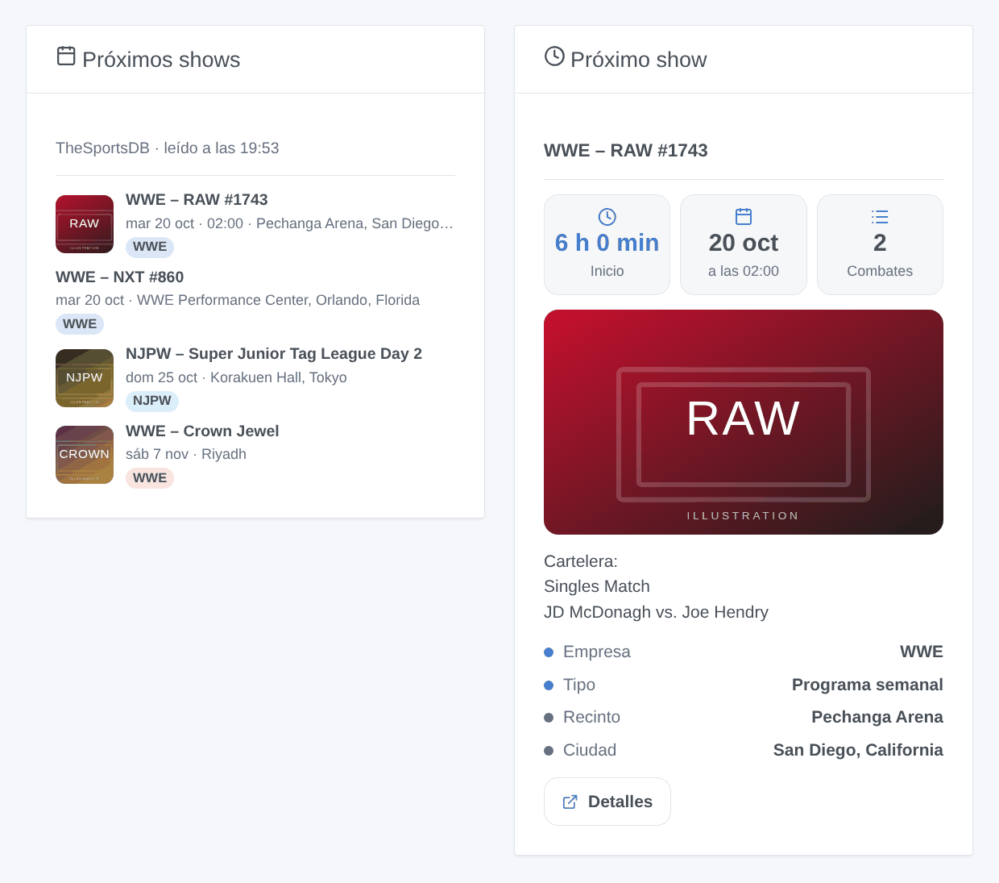

# Gladys Wrestling Events

[English](README.md) · [Français](README.fr.md) · [Deutsch](README.de.md) · **Español**

[](LICENSE)
[](https://github.com/William-De71/gladys-wrestling-events/releases)
[](https://github.com/William-De71/gladys-wrestling-events/actions/workflows/release.yml)
[](https://gladysassistant.com)


Una integración externa de [Gladys Assistant](https://gladysassistant.com) para seguir la **lucha libre profesional**: los shows de WWE, AEW, NJPW, TNA, AAA y otras nueve empresas llegan al calendario de Gladys, con su hora, su recinto y su cartelera. Las escenas pueden encender la tele antes de que suene la campana, y dos widgets muestran lo que viene.

Documentación de usuario: [English](docs/en.md) · [Français](docs/fr.md) · [Deutsch](docs/de.md) · [Español](docs/es.md).

> Integración de la comunidad, sin relación con TheSportsDB, Cagematch ni ninguna empresa, ni respaldada por ellos.

## Funciones

- **14 empresas** para elegir en una lista: WWE, AEW, NJPW, TNA, AAA, ROH, CMLL, Stardom, AJPW, DDT, Dragon Gate, GCW, RevPro, MLP.
- **Tres tipos de shows**, cada uno se puede descartar: programas semanales (RAW, SmackDown, NXT, Dynamite, Collision, AAA on FOX…), shows de gira («Day 1», «Day 2»…) y grandes eventos (PLE, pay-per-view, especiales).
- **Un calendario por empresa** para cada usuario que activa la integración en «Mis calendarios»: eventos con hora cuando se conoce, de día completo si no, con el recinto, la cartelera y un enlace a TheSportsDB.
- **3 disparadores de escena**, **1 acción de escena** y **2 widgets** de panel (más abajo).
- La **clave gratuita** de TheSportsDB (30 días por adelantado) o su **clave premium** (90 días, temporadas enteras de una vez).
- Cuatro idiomas en todas partes: inglés, francés, alemán, español.

## Cómo funciona




El programa procede de [TheSportsDB](https://www.thesportsdb.com), una base de datos deportiva abierta que mantiene al día su comunidad y que clasifica la lucha libre en «Fighting», una liga por empresa. Primero se pensó en [Cagematch](https://www.cagematch.net): no tiene API, protege sus páginas contra los accesos automatizados y pide a los robots una petición cada 9 minutos, así que la integración no lo lee.

Con la **clave gratuita**, la integración pide **un día de una empresa por petición**, una petición cada 7 segundos: los días de ayer a pasado mañana cada 3 horas (horas, carteleras y resultados cambian), los días más lejanos una vez al día. Una primera lectura de 30 días para 5 empresas tarda unos 20 minutos; tras un reinicio, solo se vuelve a leer lo pendiente. Con una **clave premium**, la temporada entera de una empresa es una sola petición, cada 3 horas.

Cada respuesta sustituye los shows guardados para ese día: un show cancelado sale del calendario, uno movido lo sigue. Los cambios activan las escenas y después se vuelven a publicar los calendarios de los usuarios que activaron la integración.



### Transporte

Solo nube (`"transports": ["cloud"]`): el catálogo muestra el distintivo de nube. Solo los ids de liga de las empresas elegidas y los días pedidos van a `www.thesportsdb.com`; los carteles de los widgets se descargan de `r2.thesportsdb.com` cuando un panel los muestra. Nada sobre usted ni su casa sale de su red. No hay camino local, así que no aparece el botón «Preferir la conexión local».

## Calendarios y eventos

Sin dispositivos: Gladys no permite que una integración sea a la vez de calendario y de dispositivos. Cada empresa seguida es un calendario, para cada usuario que activó la integración.

| Elemento             | Contenido                                                                                        |
| -------------------- | ------------------------------------------------------------------------------------------------ |
| Calendario           | «Lucha libre – WWE», color de la empresa, privado hasta que lo comparta                          |
| Evento con hora      | La hora de inicio, un final estimado (2 h para un programa, 3 h para un show de gira, 4 h si no) |
| Evento de día entero | Cuando TheSportsDB aún no conoce la hora, el día en el lugar                                     |
| Título               | La empresa y el nombre: «WWE – Crown Jewel»; «(aplazado)» si es el caso                          |
| Lugar                | Recinto, ciudad y país                                                                           |
| Descripción          | La cartelera (un combate por línea), el tipo de show, la fuente                                  |
| Enlace               | La página del show en TheSportsDB                                                                |

La ventana va de 7 días atrás hasta el horizonte (14 o 30 días, 60 o 90 con una clave premium). En «Mis calendarios», cada usuario puede dejar de sincronizar un calendario o **compartirlo con el hogar**: solo un calendario compartido llega a las escenas del hogar y al disparador nativo «Se acerca un evento del calendario».

## Disparadores, acciones de escena y widgets



**Disparadores de escena** (una vez por transición; un día leído por primera vez no anuncia nada). Filtros: empresas, tipos de shows.

- **Empieza un show**: al inicio, o 15, 30, 60 o 120 minutos antes (filtro «Cuándo»). Solo si se conoce la hora, nunca para un show aplazado.
- **Nuevo show anunciado**: un show aparece en un día ya leído (añadido a TheSportsDB, no solo visto por primera vez).
- **Combates añadidos a una cartelera**: nuevos combates en la cartelera de un show próximo (`new_matches`, uno por línea).

Las variables: `title`, `name`, `promotion`, `promotion_name`, `kind`, `date`, `time`, `venue`, `city`, `country`, `place`, `card`, `url`, `show_id` (y `lead_minutes`, `new_matches`, `new_match_count`).

**Acción de escena**: **próximo show** (de algunas empresas o tipos): título, fecha, hora, lugar, minutos hasta el inicio, cartelera, enlace y una frase lista («Próximo show: WWE – RAW #1743, martes 20 de octubre a las 02:00, Pechanga Arena…»).

**Widgets**: **Próximos shows** (una lista con fecha, hora, recinto, una etiqueta por empresa y el cartel; un toque abre la cartelera) y **Próximo show** (cuenta atrás, hora, número de combates, cartel, recinto y cartelera). Ajustes: empresas, tipos de shows, número de shows mostrados.

Ejemplos:

- Cuando **un gran evento de WWE o AEW empiece en 15 minutos** → encender la tele, atenuar las luces del salón.
- Cuando **se anuncie un nuevo show de NJPW** → enviarme `{{triggerEvent.data.title}}, {{triggerEvent.data.date}} en {{triggerEvent.data.city}}`.
- Cada lunes a las 9 → **obtener el próximo show** y enviar `{{text}}` por Telegram.

## Requisitos

- Gladys Assistant **5.2.0** o posterior (integraciones de calendario). Las instancias más antiguas no pueden instalar la integración.
- Acceso a internet. Sin cuenta; una clave premium de TheSportsDB es opcional.

## Instalación

- **Desde la tienda de Gladys** (Integraciones → Integraciones externas), con un clic, una vez indexada.
- **Desde la URL del repositorio**: `https://github.com/William-De71/gladys-wrestling-events`.
- **Modo desarrollador**: construya la imagen en local (`docker build -t gladys-wrestling-events .`) e instálela desde Gladys.

## Configuración

| Campo                               | Descripción                                                                            |
| ----------------------------------- | -------------------------------------------------------------------------------------- |
| Empresas                            | Las empresas a seguir (WWE, AEW, NJPW, TNA y AAA por defecto). Un calendario cada una. |
| Tipos de shows                      | Programas semanales, shows de gira, grandes eventos (todos por defecto).               |
| Programa por adelantado             | 2 semanas, 30 días (por defecto); 60 o 90 días con una clave premium.                  |
| Clave de API premium (opcional)     | La clave de una suscripción a TheSportsDB. Vacía: la clave gratuita.                   |
| Idioma de los textos de las escenas | Automático (el idioma del panel) o un idioma fijo, para la frase de la acción.         |

Después, en **Mis calendarios** en la misma página, pulse **Activar para mí**: cada usuario que quiera los calendarios activa la integración para sí mismo.

## Uso

1. Elija las empresas y los tipos de shows, y guarde.
2. En **Mis calendarios**, pulse **Activar para mí**; comparta los calendarios con el hogar para usarlos en escenas.
3. Añada los widgets a un panel y cree escenas con los disparadores de arriba.

## Desarrollo

```bash
npm install
npm test                       # node --test, nunca toca la red
npm run lint && npm run format:check
npx github:GladysAssistant/integration-store . --skip-image-check
scripts/build-cover.sh         # cover.jpg desde docs/assets/cover.svg
docs/illustrations/render.sh   # docs/assets/widgets.<idioma>.png
node .github/scripts/release.mjs next
```

En local, el SDK lee `GLADYS_HOST_API_URL`, `GLADYS_INTEGRATION_TOKEN` y `GLADYS_INTEGRATION_SELECTOR`, y `TZ` fija la zona horaria de las horas mostradas; `DEBUG=gladys-integration-sdk` muestra los registros del SDK y comprueba cada contenido de widget. Las pruebas usan respuestas reales de TheSportsDB, reducidas (`test/fixtures/`). Las reglas del proyecto están en [CLAUDE.md](CLAUDE.md).

## Proceso de publicación


Cada fusión en `main` lanza la CI y luego calcula la versión a partir de los [Conventional Commits](https://www.conventionalcommits.org/es/) desde la última etiqueta: `feat` → menor, `fix` / `perf` → parche, `!` o `BREAKING CHANGE` → mayor (una menor antes de 1.0.0); `docs`, `chore`, `ci`, `test`, `style`, `refactor`, `build` solos no publican nada. Se genera la sección del changelog, se sube la etiqueta, se construye la imagen multiarquitectura, después `main` recibe el commit de publicación, se crea la GitHub Release y un último trabajo comprueba la imagen pública, el validador de la tienda y el topic.

- El título de la pull request se convierte en el commit de squash y luego en la línea del changelog: escríbalo en inglés, para el usuario (`pr-title.yml` lo comprueba). No edite nunca `CHANGELOG.md` a mano.
- La 1.0.0 es una decisión: Actions → Release → Run workflow con `release-as: 1.0.0`. `dry-run` muestra la versión y las notas sin publicar nada.
- **Rama protegida**: la publicación sube su commit a `main` con `GITHUB_TOKEN`. Con un ruleset en `main`, añada GitHub Actions a su lista de excepciones (o suba mediante una GitHub App); si no, el trabajo de publicación falla explicándolo.
- Tras la primera publicación, haga público el paquete de `ghcr.io` (Package settings → Change visibility); si no, Gladys no puede descargarlo.

## Solución de problemas

Vea [docs/es.md](docs/es.md#solución-de-problemas). Informe de un problema con las versiones de Gladys y de la integración, las empresas seguidas, clave gratuita o premium, y las líneas de la pestaña Registros.

## Contribuir

Issues y pull requests son bienvenidas. Ejecute `npm run format:check && npm run lint && npm test` antes de abrir una pull request y no cambie ningún id externo ni ninguna clave guardada (vea [CLAUDE.md](CLAUDE.md)). Se puede añadir una empresa que falte si TheSportsDB la tiene como liga con un programa actual.

## Seguridad

Vea [SECURITY.md](SECURITY.md): informe de las vulnerabilidades en privado. La clave premium es un campo secreto, nunca escrito en los registros; la integración funciona en solo lectura, sin derechos de root, en su contenedor, y solo contacta con TheSportsDB.

## Capturas pendientes

Las imágenes de arriba son ilustraciones, no capturas. Las capturas reales irán a `docs/assets/screenshots/` (PNG, 1280 × 800): `configuration.png`, `my-calendars.png`, `calendar.png`, `scene.png`.

## Licencia

[Licencia Apache 2.0](LICENSE) — vea también [NOTICE](NOTICE). El programa procede de [TheSportsDB](https://www.thesportsdb.com): los widgets muestran la fuente y la hora de la última lectura. Gracias a la documentación y al SDK de Gladys.
