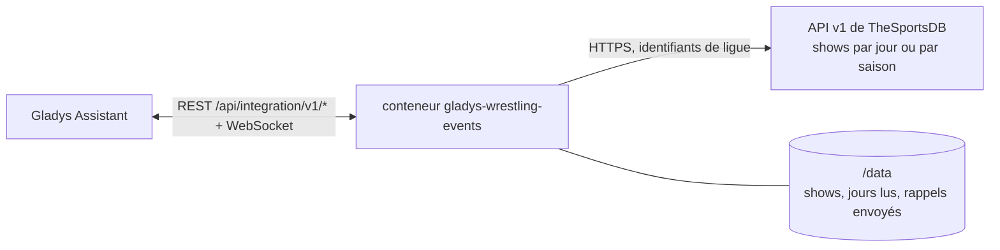
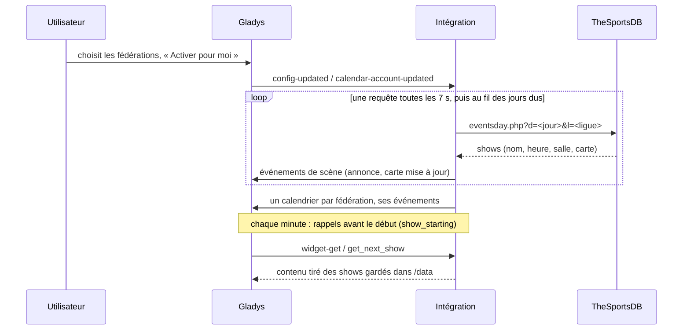
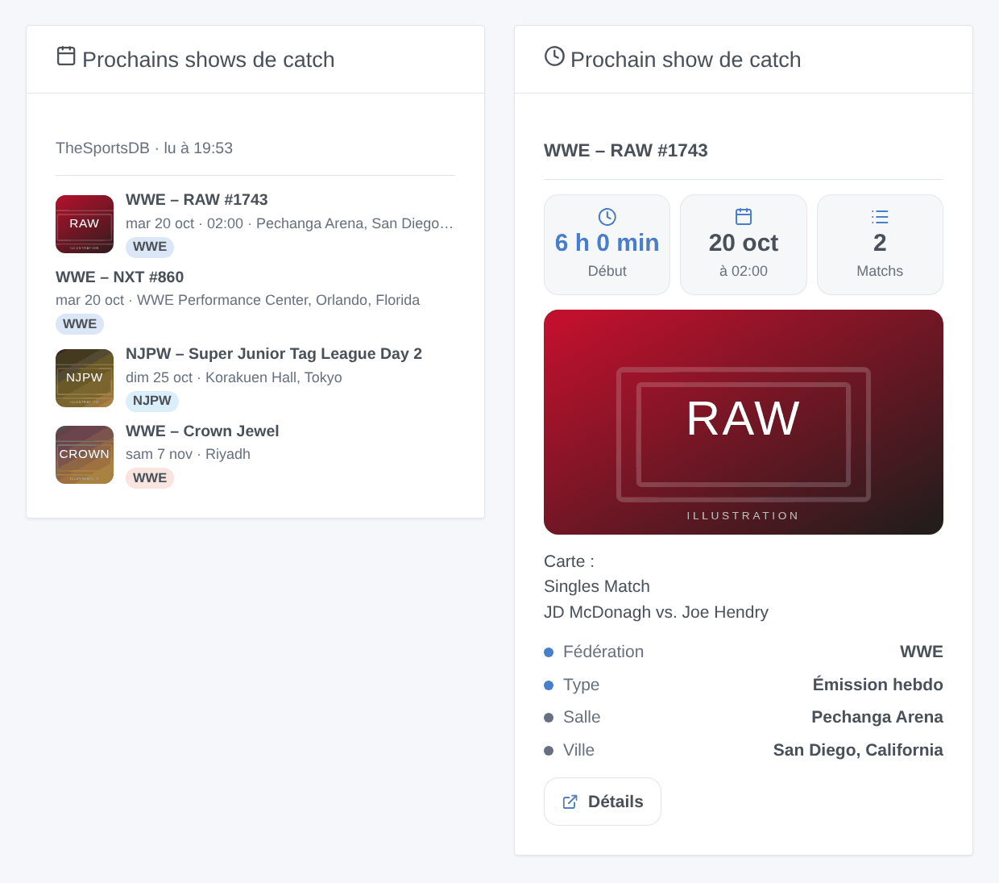

# Gladys Wrestling Events

[English](README.md) · **Français** · [Deutsch](README.de.md) · [Español](README.es.md)

[](LICENSE)
[](https://github.com/William-De71/gladys-wrestling-events/releases)
[](https://github.com/William-De71/gladys-wrestling-events/actions/workflows/release.yml)
[](https://gladysassistant.com)


Une intégration externe de [Gladys Assistant](https://gladysassistant.com) pour suivre le **catch** : les shows de la WWE, de l'AEW, de la NJPW, de TNA, de AAA et de neuf autres fédérations arrivent dans le calendrier de Gladys, avec leur heure, leur salle et leur carte. Des scènes peuvent allumer la télé avant le début du show, et deux widgets montrent ce qui arrive.

Documentation utilisateur : [English](docs/en.md) · [Français](docs/fr.md) · [Deutsch](docs/de.md) · [Español](docs/es.md).

> Intégration communautaire, sans lien avec TheSportsDB, Cagematch ni aucune fédération, ni approuvée par eux.

## Fonctionnalités

- **14 fédérations** à choisir dans une liste : WWE, AEW, NJPW, TNA, AAA, ROH, CMLL, Stardom, AJPW, DDT, Dragon Gate, GCW, RevPro, MLP.
- **Trois types de shows**, chacun peut être écarté : les émissions hebdo (RAW, SmackDown, NXT, Dynamite, Collision, AAA on FOX…), les shows de tournée (« Day 1 », « Day 2 »…) et les grands événements (PLE, pay-per-view, spéciaux).
- **Un calendrier par fédération** pour chaque utilisateur qui active l'intégration dans « Mes calendriers » : un événement horaire quand l'heure est connue, sur la journée sinon, avec la salle, la carte et un lien vers TheSportsDB.
- **3 déclencheurs de scène**, **1 action de scène** et **2 widgets** de tableau de bord (ci-dessous).
- La **clé gratuite** de TheSportsDB (30 jours à l'avance), ou votre **clé premium** (90 jours, des saisons entières d'un coup).
- Quatre langues partout : anglais, français, allemand, espagnol.

## Fonctionnement




Le programme vient de [TheSportsDB](https://www.thesportsdb.com), une base de données sportive ouverte tenue à jour par sa communauté, qui range le catch dans « Fighting », une ligue par fédération. [Cagematch](https://www.cagematch.net) a été envisagé d'abord : il n'a pas d'API, protège ses pages contre les accès automatisés et demande aux robots une requête toutes les 9 minutes ; l'intégration ne le lit donc pas.

Avec la **clé gratuite**, l'intégration demande **un jour d'une fédération par requête**, une requête toutes les 7 secondes : les jours d'hier à après-demain toutes les 3 heures (heures, cartes et résultats bougent), les jours plus lointains une fois par jour. Une première lecture de 30 jours pour 5 fédérations prend une vingtaine de minutes ; après un redémarrage, seul ce qui est dû est relu. Avec une **clé premium**, la saison entière d'une fédération tient en une requête, toutes les 3 heures.

Chaque réponse remplace les shows gardés pour ce jour : un show annulé quitte le calendrier, un show déplacé suit. Les changements déclenchent les scènes, puis les calendriers des utilisateurs qui ont activé l'intégration sont republiés.



### Transport

Cloud uniquement (`"transports": ["cloud"]`) : le catalogue affiche le badge cloud. Seuls les identifiants de ligue des fédérations choisies et les jours demandés partent vers `www.thesportsdb.com` ; les affiches des widgets sont téléchargées depuis `r2.thesportsdb.com` quand un tableau de bord les affiche. Rien sur vous ni sur votre maison ne quitte votre réseau. Il n'y a pas de chemin local, donc pas de bouton « Préférer la connexion locale ».

## Calendriers et événements

Pas d'appareils : Gladys ne permet pas à une intégration d'être à la fois de type calendrier et appareil. Chaque fédération suivie est un calendrier, pour chaque utilisateur qui a activé l'intégration.

| Élément              | Contenu                                                                                           |
| -------------------- | ------------------------------------------------------------------------------------------------- |
| Calendrier           | « Catch – WWE », couleur de la fédération, privé tant que vous ne le partagez pas                 |
| Événement horaire    | L'heure du début, une fin estimée (2 h pour une émission, 3 h pour un show de tournée, 4 h sinon) |
| Événement de journée | Quand TheSportsDB ne connaît pas encore l'heure, le jour sur place                                |
| Titre                | La fédération et le nom : « WWE – Crown Jewel » ; « (reporté) » le cas échéant                    |
| Lieu                 | Salle, ville et pays                                                                              |
| Description          | La carte (un match par ligne), le type de show, la source                                         |
| Lien                 | La page du show sur TheSportsDB                                                                   |

La fenêtre va de 7 jours en arrière jusqu'à l'horizon (14 ou 30 jours, 60 ou 90 avec une clé premium). Dans « Mes calendriers », chaque utilisateur peut arrêter la synchronisation d'un calendrier ou le **partager avec le foyer** : seul un calendrier partagé atteint les scènes du foyer et le déclencheur natif « Un évènement dans le calendrier arrive ».

## Déclencheurs, actions de scène et widgets



**Déclencheurs de scène** (une fois par transition ; un jour lu pour la première fois n'annonce rien). Filtres : fédérations, types de shows.

- **Un show commence** : au début, ou 15, 30, 60 ou 120 minutes avant (filtre « Quand »). Seulement si l'heure est connue, jamais pour un show reporté.
- **Nouveau show annoncé** : un show apparaît sur un jour déjà lu (ajouté à TheSportsDB, pas seulement vu pour la première fois).
- **Matchs ajoutés à une carte** : de nouveaux matchs sur la carte d'un show à venir (`new_matches`, un par ligne).

Les variables : `title`, `name`, `promotion`, `promotion_name`, `kind`, `date`, `time`, `venue`, `city`, `country`, `place`, `card`, `url`, `show_id` (et `lead_minutes`, `new_matches`, `new_match_count`).

**Action de scène** : **prochain show** (de certaines fédérations ou de certains types) : titre, date, heure, lieu, minutes avant le début, carte, lien et une phrase toute faite (« Prochain show : WWE – RAW #1743, mardi 20 octobre à 02:00, Pechanga Arena… »).

**Widgets** : **Prochains shows de catch** (une liste avec date, heure, salle, un badge par fédération et l'affiche ; un appui ouvre la carte) et **Prochain show de catch** (compte à rebours, heure, nombre de matchs, affiche, salle et carte). Réglages : fédérations, types de shows, nombre de shows listés.

Exemples :

- Quand **un grand événement WWE ou AEW commence dans 15 minutes** → allumer la télé, tamiser les lumières du salon.
- Quand **un nouveau show NJPW est annoncé** → m'envoyer `{{triggerEvent.data.title}}, {{triggerEvent.data.date}} à {{triggerEvent.data.city}}`.
- Chaque lundi à 9 h → **lire le prochain show** et envoyer `{{text}}` sur Telegram.

## Prérequis

- Gladys Assistant **5.3.0** ou plus récent (intégrations de type calendrier ; mots-clés et pays du catalogue de Gladys 5.3). Les instances plus anciennes ne peuvent pas installer l'intégration.
- Un accès à internet. Aucun compte ; une clé premium de TheSportsDB est facultative.

## Installation

- **Depuis le store de Gladys** (Intégrations → Intégrations externes), en un clic, une fois indexée.
- **Depuis l'URL du dépôt** : `https://github.com/William-De71/gladys-wrestling-events`.
- **Mode développeur** : construisez l'image en local (`docker build -t gladys-wrestling-events .`) et installez-la depuis Gladys.

## Configuration

| Champ                           | Description                                                                                |
| ------------------------------- | ------------------------------------------------------------------------------------------ |
| Fédérations                     | Les fédérations à suivre (WWE, AEW, NJPW, TNA et AAA par défaut). Un calendrier chacune.   |
| Types de shows                  | Émissions hebdo, shows de tournée, grands événements (tous par défaut).                    |
| Programme à l'avance            | 2 semaines, 30 jours (par défaut) ; 60 ou 90 jours avec une clé premium.                   |
| Clé d'API premium (facultative) | La clé d'un abonnement TheSportsDB. Vide : la clé gratuite.                                |
| Langue des textes des scènes    | Automatique (la langue du tableau de bord) ou une langue fixe, pour la phrase de l'action. |

Ensuite, dans **Mes calendriers** sur la même page, appuyez sur **Activer pour moi** : chaque utilisateur qui veut les calendriers active l'intégration pour lui-même.

## Utilisation

1. Choisissez les fédérations et les types de shows, puis enregistrez.
2. Dans **Mes calendriers**, appuyez sur **Activer pour moi** ; partagez les calendriers avec le foyer pour les utiliser dans des scènes.
3. Ajoutez les widgets à un tableau de bord et créez des scènes avec les déclencheurs ci-dessus.

## Développement

```bash
npm install
npm test                       # node --test, sans jamais toucher au réseau
npm run lint && npm run format:check
npx github:GladysAssistant/integration-store . --skip-image-check
scripts/build-cover.sh         # cover.jpg depuis docs/assets/cover.svg
docs/illustrations/render.sh   # docs/assets/widgets.<langue>.png
node .github/scripts/release.mjs next
```

En local, le SDK lit `GLADYS_HOST_API_URL`, `GLADYS_INTEGRATION_TOKEN` et `GLADYS_INTEGRATION_SELECTOR`, et `TZ` fixe le fuseau horaire des heures affichées ; `DEBUG=gladys-integration-sdk` affiche les journaux du SDK et vérifie chaque contenu de widget. Les tests utilisent de vraies réponses de TheSportsDB, réduites (`test/fixtures/`). Les règles du projet sont dans [CLAUDE.md](CLAUDE.md).

## Processus de release


Chaque fusion sur `main` lance la CI, puis calcule la version à partir des [Conventional Commits](https://www.conventionalcommits.org/fr/) depuis le dernier tag : `feat` → mineure, `fix` / `perf` → correctif, `!` ou `BREAKING CHANGE` → majeure (une mineure avant 1.0.0) ; `docs`, `chore`, `ci`, `test`, `style`, `refactor`, `build` seuls ne publient rien. La section du changelog est générée, le tag poussé, l'image multi-architecture construite, puis `main` reçoit le commit de release, la GitHub Release est créée et un dernier job vérifie l'image publique, le validateur du store et le topic.

- Le titre de la pull request devient le commit de squash, puis la ligne du changelog : écrivez-le en anglais, pour l'utilisateur (`pr-title.yml` le vérifie). N'éditez jamais `CHANGELOG.md` à la main.
- La 1.0.0 est une décision : Actions → Release → Run workflow avec `release-as: 1.0.0`. `dry-run` montre la version et les notes sans rien publier.
- **Branche protégée** : la release pousse son commit sur `main` avec `GITHUB_TOKEN`. Avec une règle sur `main`, ajoutez GitHub Actions à sa liste de contournement (ou poussez via une GitHub App), sinon le job de publication échoue en l'expliquant.
- Après la première release, rendez le package `ghcr.io` public (Package settings → Change visibility), sinon Gladys ne peut pas le télécharger.

## Dépannage

Voir [docs/fr.md](docs/fr.md#dépannage). Signalez un problème avec les versions de Gladys et de l'intégration, les fédérations suivies, clé gratuite ou premium, et les lignes de l'onglet Journaux.

## Contribuer

Issues et pull requests bienvenues. Lancez `npm run format:check && npm run lint && npm test` avant d'ouvrir une pull request, et ne changez aucun identifiant externe ni aucune clé stockée (voir [CLAUDE.md](CLAUDE.md)). Une fédération absente de la liste peut être ajoutée si TheSportsDB l'a comme ligue avec un programme à jour.

## Sécurité

Voir [SECURITY.md](SECURITY.md) : signalez les vulnérabilités en privé. La clé premium est un champ secret, jamais écrit dans les journaux ; l'intégration tourne en lecture seule, sans droits root, dans son conteneur, et ne contacte que TheSportsDB.

## Captures à venir

Les images ci-dessus sont des illustrations, pas des captures d'écran. Les vraies captures iront dans `docs/assets/screenshots/` (PNG, 1280 × 800) : `configuration.png`, `my-calendars.png`, `calendar.png`, `scene.png`.

## Licence

[Licence Apache 2.0](LICENSE) — voir aussi [NOTICE](NOTICE). Le programme vient de [TheSportsDB](https://www.thesportsdb.com) : les widgets affichent la source et l'heure de la dernière lecture. Merci à la documentation et au SDK de Gladys.
