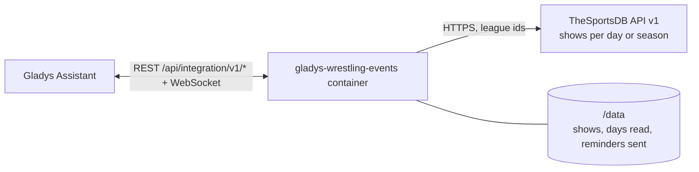
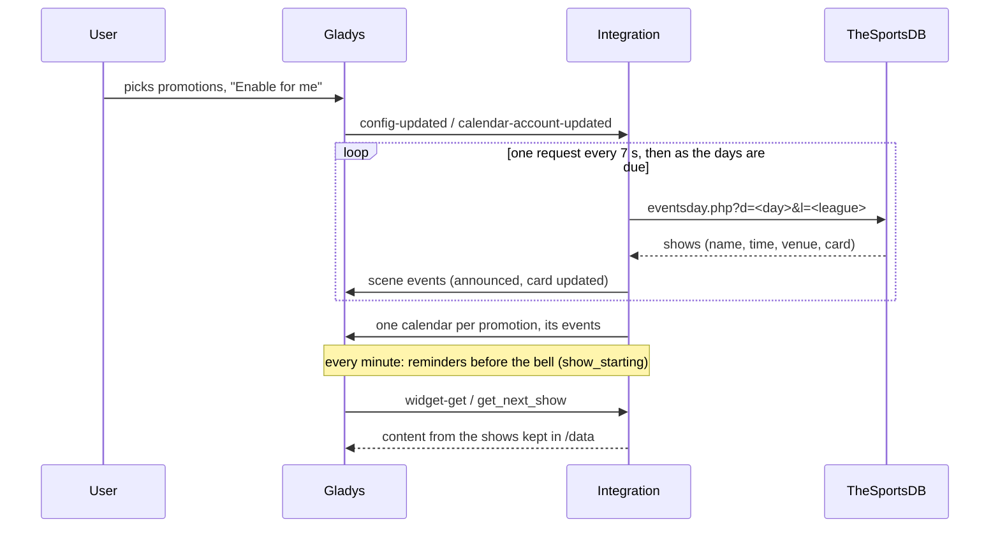
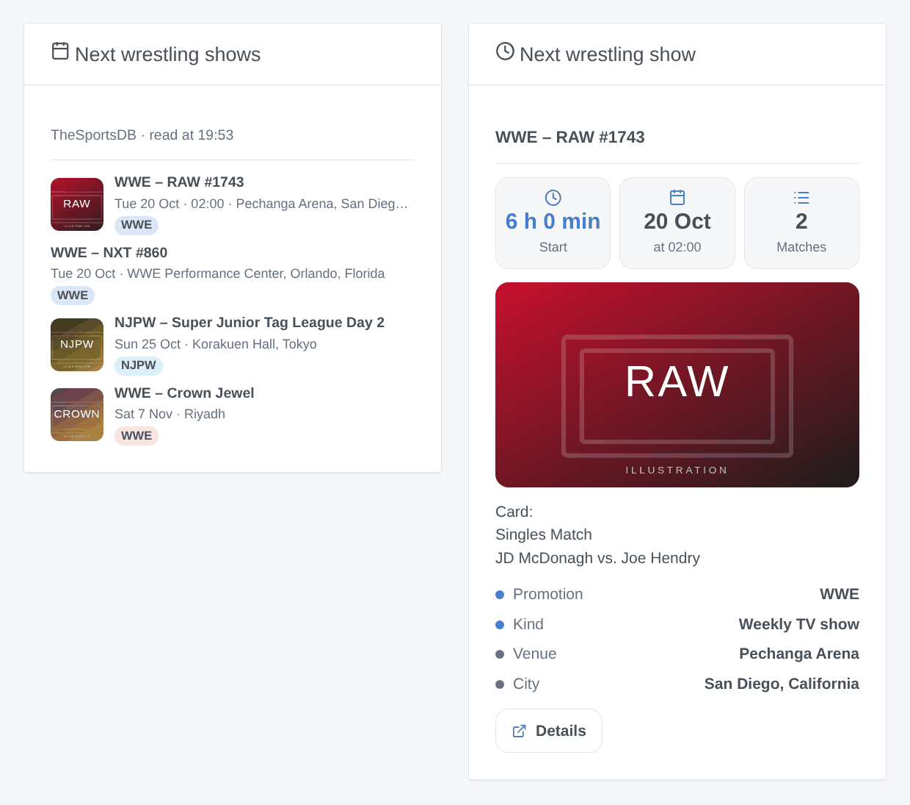

# Gladys Wrestling Events

**English** · [Français](README.fr.md) · [Deutsch](README.de.md) · [Español](README.es.md)

[](LICENSE)
[](https://github.com/William-De71/gladys-wrestling-events/releases)
[](https://github.com/William-De71/gladys-wrestling-events/actions/workflows/release.yml)
[](https://gladysassistant.com)


A [Gladys Assistant](https://gladysassistant.com) external integration that follows **professional wrestling**: the shows of WWE, AEW, NJPW, TNA, AAA and nine other promotions land in the Gladys calendar, with their time, venue and card. Scenes can switch the TV on before the bell, and two dashboard widgets show what is coming.

User documentation: [English](docs/en.md) · [Français](docs/fr.md) · [Deutsch](docs/de.md) · [Español](docs/es.md).

> Community integration, not affiliated with or endorsed by TheSportsDB, Cagematch or any promotion.

## Features

- **14 promotions** to pick in a list: WWE, AEW, NJPW, TNA, AAA, ROH, CMLL, Stardom, AJPW, DDT, Dragon Gate, GCW, RevPro, MLP.
- **Three kinds of shows**, each can be left out: weekly TV shows (RAW, SmackDown, NXT, Dynamite, Collision, AAA on FOX…), tour shows ("Day 1", "Day 2"…) and major events (premium live events, pay-per-views, specials).
- **One calendar per promotion** for every user who enables the integration in "My calendars": timed events when the time is known, all-day otherwise, with the venue, the card and a link to TheSportsDB.
- **3 scene triggers**, **1 scene action** and **2 dashboard widgets** (below).
- The **free key** of TheSportsDB (30 days ahead), or your **premium key** (90 days ahead, whole seasons at once).
- Four languages everywhere: English, French, German, Spanish.

## How it works




The program comes from [TheSportsDB](https://www.thesportsdb.com), an open sports database kept up to date by its community, which files wrestling under "Fighting", one league per promotion. [Cagematch](https://www.cagematch.net) was considered first: it has no API, protects its pages against automated access and asks robots for one request every 9 minutes, so the integration does not read it.

With the **free key**, the integration asks for **one day of one promotion per request**, one request every 7 seconds: the days from yesterday to the day after tomorrow every 3 hours (times, cards and results move), the farther days once a day. A first reading of 30 days for 5 promotions takes about 20 minutes; after a restart, only what is due is read again. With a **premium key**, a whole season of a promotion is one request, every 3 hours.

Each answer replaces the shows kept for that day: a cancelled show leaves the calendar, a moved one follows. The changes fire the scene triggers, then the calendars of the users who enabled the integration are published again.



### Transport

Cloud only (`"transports": ["cloud"]`): the catalog shows the cloud badge. Only the league ids of the chosen promotions and the days asked go to `www.thesportsdb.com`; the posters of the widgets are downloaded from `r2.thesportsdb.com` when a dashboard shows them. Nothing about you or your home leaves your network. There is no local path, hence no "Prefer the local connection" button.

## Calendars and events

No devices: Gladys does not let one integration be both a calendar and a device integration. Each followed promotion is a calendar, for each user who enabled the integration.

| Item          | Content                                                                                        |
| ------------- | ---------------------------------------------------------------------------------------------- |
| Calendar      | "Wrestling – WWE" (FR "Catch – WWE"), color of the promotion, private until you share it       |
| Timed event   | The time of the bell, an estimated end (2 h for a TV show, 3 h for a tour show, 4 h otherwise) |
| All-day event | When TheSportsDB does not know the time yet, on the day at the venue                           |
| Title         | The promotion and the name: "WWE – Crown Jewel"; "(postponed)" when it is                      |
| Place         | Venue, city and country                                                                        |
| Description   | The card (one match per line), the kind of show, the source                                    |
| Link          | The page of the show on TheSportsDB                                                            |

The window goes from 7 days back to the horizon (14 or 30 days, 60 or 90 with a premium key). In "My calendars", each user can stop synchronizing a calendar or **share it with the household**: only a shared calendar reaches the scenes of the household and the native "Calendar event is coming" trigger.

## Scene triggers, actions and widgets



**Scene triggers** (once per transition; a day read for the first time announces nothing). Filters: promotions, kinds of shows.

- **A show starts**: at the bell, or 15, 30, 60 or 120 minutes before (filter "When"). Only when the time is known, never for a postponed show.
- **New show announced**: a show appears on a day already read (added to TheSportsDB, not merely seen for the first time).
- **Matches added to a card**: new matches on the card of a show to come (`new_matches`, one per line).

The variables: `title`, `name`, `promotion`, `promotion_name`, `kind`, `date`, `time`, `venue`, `city`, `country`, `place`, `card`, `url`, `show_id` (and `lead_minutes`, `new_matches`, `new_match_count`).

**Scene action**: **next show** (of some promotions or kinds): title, date, time, place, minutes until the start, card, link and a ready-made sentence ("Next show: WWE – RAW #1743, Tuesday 20 October at 02:00, Pechanga Arena…").

**Widgets**: **Next wrestling shows** (a list with date, time, venue, a badge per promotion and the poster; a tap opens the card) and **Next wrestling show** (countdown, time, number of matches, poster, venue and card). Settings: promotions, kinds of shows, number of shows listed.

Examples:

- When **a WWE or AEW major event starts in 15 minutes** → switch the TV on, dim the living room lights.
- When **a new NJPW show is announced** → send me `{{triggerEvent.data.title}}, {{triggerEvent.data.date}} in {{triggerEvent.data.city}}`.
- Every Monday at 9 am → **get the next show** and send `{{text}}` on Telegram.

## Requirements

- Gladys Assistant **5.3.0** or later (calendar integrations; catalog keywords and countries of Gladys 5.3). Older instances cannot install the integration.
- Internet access. No account; a premium key of TheSportsDB is optional.

## Installation

- **From the Gladys store** (Integrations → External integrations), in one click, once indexed.
- **From the repository URL**: `https://github.com/William-De71/gladys-wrestling-events`.
- **Developer mode**: build the image locally (`docker build -t gladys-wrestling-events .`) and install it from Gladys.

## Configuration

| Field                       | Description                                                                                |
| --------------------------- | ------------------------------------------------------------------------------------------ |
| Promotions                  | The promotions to follow (WWE, AEW, NJPW, TNA and AAA by default). One calendar each.      |
| Kinds of shows              | Weekly TV shows, tour shows, major events (all by default).                                |
| Program ahead               | 2 weeks, 30 days (default); 60 or 90 days with a premium key.                              |
| Premium API key (optional)  | A key of a TheSportsDB subscription. Empty: the free key.                                  |
| Language of the scene texts | Automatic (the language of the dashboard), or a fixed language, for the scene action text. |

Then, in **My calendars** on the same page, press **Enable for me**: each user who wants the calendars enables the integration for themselves.

## Usage

1. Pick the promotions and the kinds of shows, then save.
2. In **My calendars**, press **Enable for me**; share the calendars with the household to use them in scenes.
3. Add the widgets to a dashboard, and create scenes with the triggers above.

## Development

```bash
npm install
npm test                       # node --test, never touches the network
npm run lint && npm run format:check
npx github:GladysAssistant/integration-store . --skip-image-check
scripts/build-cover.sh         # cover.jpg from docs/assets/cover.svg
docs/illustrations/render.sh   # docs/assets/widgets.<lang>.png
node .github/scripts/release.mjs next
```

Locally, the SDK reads `GLADYS_HOST_API_URL`, `GLADYS_INTEGRATION_TOKEN` and `GLADYS_INTEGRATION_SELECTOR`, and `TZ` sets the timezone of the times shown; `DEBUG=gladys-integration-sdk` prints the SDK logs and checks every widget content. The tests use real answers of TheSportsDB, reduced (`test/fixtures/`). The rules of the project are in [CLAUDE.md](CLAUDE.md).

## Release process


Every merge on `main` runs the CI, then computes the version from the [Conventional Commits](https://www.conventionalcommits.org/) since the last tag: `feat` → minor, `fix` / `perf` → patch, `!` or `BREAKING CHANGE` → major (a minor before 1.0.0); `docs`, `chore`, `ci`, `test`, `style`, `refactor`, `build` alone publish nothing. The changelog section is generated, the tag pushed, the multi-arch image built, then `main` receives the release commit, the GitHub Release is created and a last job checks the public image, the store validator and the topic.

- The pull request title becomes the squash commit, then the changelog line: write it in English, for the user (`pr-title.yml` checks it). Never edit `CHANGELOG.md` by hand.
- 1.0.0 is a decision: Actions → Release → Run workflow with `release-as: 1.0.0`. `dry-run` shows the version and the notes without publishing anything.
- **Protected branch**: the release pushes its commit to `main` with `GITHUB_TOKEN`. With a ruleset on `main`, add GitHub Actions to its bypass list (or push through a GitHub App), otherwise the publish job fails with instructions.
- After the first release, make the `ghcr.io` package public (Package settings → Change visibility), otherwise Gladys cannot download it.

## Troubleshooting

See [docs/en.md](docs/en.md#troubleshooting). Report problems with the Gladys and integration versions, the promotions followed, free or premium key, and the lines of the Logs tab.

## Contributing

Issues and pull requests are welcome. Run `npm run format:check && npm run lint && npm test` before opening a pull request, and keep every external id and stored key unchanged (see [CLAUDE.md](CLAUDE.md)). A promotion missing from the list can be added if TheSportsDB has it as a league with a current program.

## Security

See [SECURITY.md](SECURITY.md): report vulnerabilities privately. The premium key is a secret field, never written to the logs; the integration runs read-only, without root rights, in its container, and only contacts TheSportsDB.

## Screenshots to come

The images above are illustrations, not screenshots. Real screenshots will go to `docs/assets/screenshots/` (PNG, 1280 × 800): `configuration.png`, `my-calendars.png`, `calendar.png`, `scene.png`.

## License

[Apache License 2.0](LICENSE) — see also [NOTICE](NOTICE). The program comes from [TheSportsDB](https://www.thesportsdb.com): the widgets show the source and the time of the last reading. Thanks to the documentation and the SDK of Gladys.
